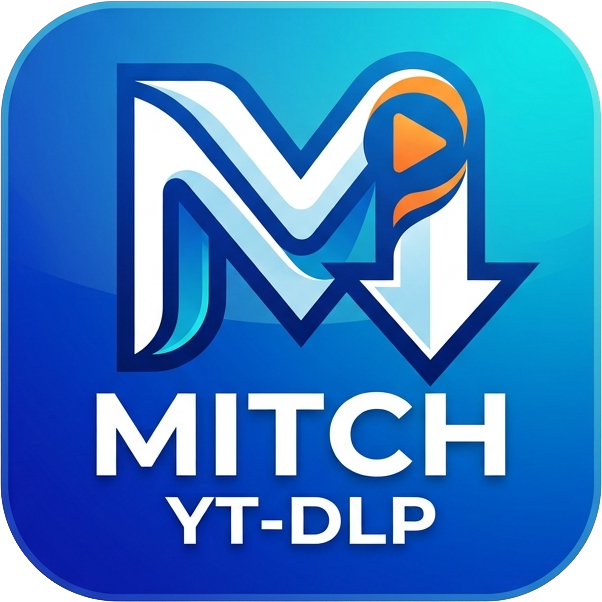
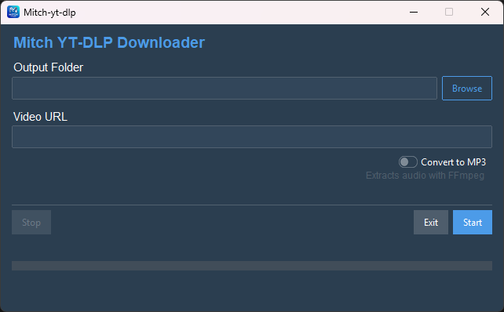

<p align="center">
  <a href="images/MitchYTLogo.png">
    
  </a>
</p>

<h1 align="center">Mitch-yt-dlp</h1>

<p align="center">
  <strong>A modern Windows GUI for <a href="https://github.com/yt-dlp/yt-dlp">yt-dlp</a></strong>
</p>

<p align="center">
    <a href="https://github.com/mitchelljfranklin/mitch-yt-dlp/releases">
      
    </a>
    <a href="https://github.com/mitchelljfranklin/mitch-yt-dlp/blob/main/LICENSE">
      
    </a>
    <a href="https://github.com/mitchelljfranklin/mitch-yt-dlp">
      
    </a>
    <br />
    <a href="https://github.com/mitchelljfranklin/mitch-yt-dlp/releases">📦 What's new</a>
</p>

---

## Features

- **Simple, clean interface** — paste a URL, pick a folder, hit Start
- **Playlist support** — download entire playlists with one click, with live video counter
- **Video-only mode** — toggle to grab just the video from a playlist link instead of every entry
- **MP3 conversion** — toggle to extract audio as MP3 (FFmpeg bundled)
- **Real-time progress** — speed, ETA, and percentage while downloading
- **Stop & Exit** — cancel downloads with Stop, close the app with Exit
- **Clear failure reporting** — playlists keep going, then list what failed
- **Remembers your settings** — output folder and toggle choices are restored
- **Keyboard shortcuts** — Enter to start, Escape to stop
- **Standalone `.exe`** — no Python installation needed, everything bundled

## Quick Start

### Option 1: Download the EXE (recommended)

Grab the latest `Mitch-yt-dlp.exe` from [Releases](https://github.com/mitchelljfranklin/mitch-yt-dlp/releases) — no setup required.

### Option 2: Run from source

```powershell
git clone https://github.com/mitchelljfranklin/mitch-yt-dlp
cd mitch-yt-dlp
python -m venv .venv
.venv\Scripts\activate
pip install -r requirements.txt
python setup_ffmpeg.py   # optional: enables MP3 conversion
python src/main.py
```

## Building from source

```powershell
# Install dependencies
pip install -r requirements.txt

# Download FFmpeg Windows binaries (required for MP3 conversion
# and enforced by build.spec)
python setup_ffmpeg.py

# Build standalone EXE
python -m PyInstaller build.spec
# Output: dist\Mitch-yt-dlp.exe
```

## How it works

Mitch-yt-dlp imports [yt-dlp](https://github.com/yt-dlp/yt-dlp) as a Python library rather than shelling out to a CLI process. This gives finer control over progress reporting and cancellation.

| Component | Technology |
|---|---|
| UI Framework | [ttkbootstrap](https://github.com/israel-dryer/ttkbootstrap) |
| Download Engine | [yt-dlp](https://github.com/yt-dlp/yt-dlp) (Python API) |
| Audio Encoding | [FFmpeg](https://ffmpeg.org/) (bundled in EXE) |
| Packaging | [PyInstaller](https://pyinstaller.org/) |



## Requirements

- **Windows 10/11** (64-bit)
- **For source installs**: Python 3.14+, plus FFmpeg in `bin/` (via `setup_ffmpeg.py`) or on `PATH` for MP3 conversion.

  The released EXE bundles Python, yt-dlp, and FFmpeg — no other dependencies.

## Contributing

See [CONTRIBUTING.md](CONTRIBUTING.md) for guidelines on reporting bugs, requesting features, and submitting PRs.

While I believe AI can be a powerful tool for development—and I personally use 'Mitch-AI' to help manage documentation and reviews—it must remain a tool in the hands of a capable developer. In this project, you are the pilot; you are responsible for coding, confirming, and refining your contributions. To help those using AI tools, I've created an AGENTS.md file specifically for your assistants to follow. Please ensure your agent adheres to these guidelines, as non-compliant code will be rejected regardless of how well it functions. Most importantly, please ensure you fully understand the code you are submitting; a 'black box' approach where AI generates code that the human contributor doesn't understand is not permitted here.

## Privacy & Security

- [PRIVACY.md](PRIVACY.md) — what data the app does (and does not) collect
- [SECURITY.md](SECURITY.md) — how to report vulnerabilities

## License

MIT — see [LICENSE](LICENSE) for details.

---

<p align="center">
  Built with ❤️ using <a href="https://github.com/israel-dryer/ttkbootstrap">ttkbootstrap</a> and <a href="https://github.com/yt-dlp/yt-dlp">yt-dlp</a>
</p>
